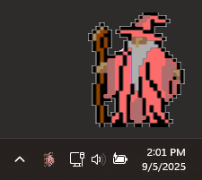
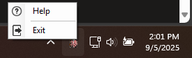
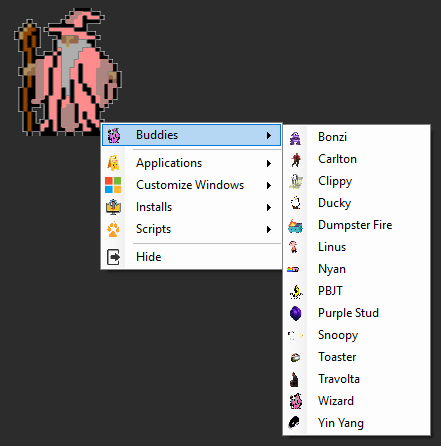
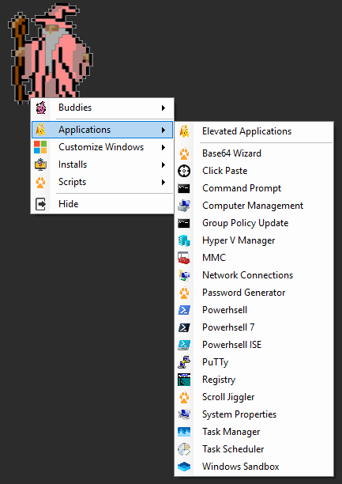
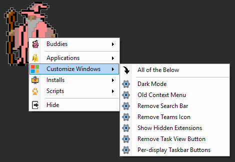
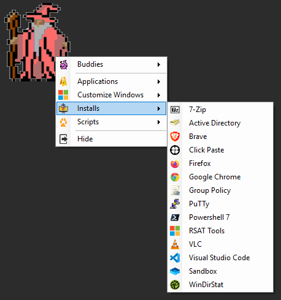
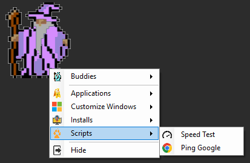
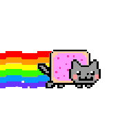
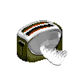

# Wizard-Buddy Tray Application
- A pixel wizard lives in the Windows system tray (bottom right).

- Interaction:
-  **Left-click** → Shows Wizard-Buddy on the desktop.

-  **Right-click** → Opens context menus, **Help**, **SimpleHelp Spy Detection**, **Start with Windows**, **Animate Tray Icon**, **Shake to Find Pointer** and Exit.
- **Shake to Find Pointer** (on by default): lost the pointer? Shake the mouse quickly back and forth and it grows for a moment, like on a Mac, then shrinks back when you stop. It keeps your own pointer style, size and color. It doesn't trigger while a mouse button is held (dragging or selecting) or while a full-screen game, video or presentation is running. Tray right-click › **Shake to Find Pointer** turns it off or on.
- **Help** opens a window that explains every click, scroll and menu.
- The tray icon shows whichever buddy you picked. Turn on **Animate Tray Icon** (tray right-click) to have it play its animation there too. You'll only see it if the icon is pinned to the taskbar rather than tucked under the ^ arrow.
- **Start with Windows** (tray right-click) starts Wizard Buddy when you sign in. A check shows it's on; click again to turn it off. It starts the same way you ran it this time: from the script file, or from GitHub if you used the `irm | iex` launcher.

## 📂 Context Menu Categories
### 1. Buddies

- Fun companions/mascots you can swap. The one you pick is checked, becomes the tray icon and is remembered next time:
- Bonzi, Carlton, Clippy, Ducky, Dumpster Fire, Linus, Nyan, PBJT, Purple Stud, Snoopy, Toaster, Travolta, Wizard, Yin Yang

### 2. Applications

- A toolbox of apps and utilities:
- **Android Emulator** — **Start** your Android virtual device, and pick:
  - **RAM** (2–16 GB, up to half your PC's memory) and **CPU Cores**
  - **Screen**: Small Phone (4.65"), Medium Phone (6.4"), Pixel 10 (6.3"), Pixel 10 Pro XL (6.8"), Pixel 10 Pro Fold (8"), Small Tablet (7") or Pixel Tablet (11"). This changes the screen only; a phone set to a tablet size still runs the phone version of Android. For the real tablet experience, use **Add Device › Tablet**.
  - **Add Device**: create a **Small Phone**, **Tablet** or **Desktop** device (each on the newest Android for its type). Works while another emulator is running.

  The current setting is checked; a change applies the next time the emulator starts. With several devices, each gets its own submenu. Offers the install if it's missing.
- Command Prompt, PowerShell, PowerShell 7, PowerShell ISE
- Computer Management, Group Policy Update, Hyper-V Manager, MMC, Network Connections
- Password Generator, Base64 Wizard, Click Paste, Scroll Jiggler
- Registry, System Properties, Task Manager, Task Scheduler

### 3. Customize Windows

- Quick tweaks for Windows UI and behavior:
- Dark Mode
- Old Context Menu
- Remove Teams Icon
- Remove Search Bar
- Remove Task View Button
- Show Hidden Extensions
- Per-display Taskbar Buttons
- Use Windows Console Host — makes the classic console window (not Windows Terminal) the default for PowerShell, cmd and scripts. Click again to go back to "Let Windows decide".
-  **All of the Below** (apply everything except Hide Widgets and Use Windows Console Host)
- Hide Widgets, No Bing in Start Search and Remove Shortcut Arrows need administrator rights. If Wizard Buddy isn't running as admin, it lists what failed and offers to **try again as administrator** (one UAC prompt). The retry still changes *your* settings, even if you sign in to the prompt with a separate admin account.

### 4. Installs

- Shortcut installers for common tools. Apps that are already installed have a check next to them.
- **Update All Apps** (at the top) updates everything winget can update, in a window that stays open until you press Enter.
- 7-Zip, Brave, Firefox, Google Chrome, VLC, Visual Studio Code, WinDirStat
- Active Directory, RSAT Tools, Group Policy — install in an administrator console (one UAC prompt) while the buddy stays usable; you're told when they finish
- PowerShell 7, PuTTY, Sandbox, Click Paste
- **Android Emulator** — installs the Android Emulator with Google's Android CLI: always the latest command-line tools, emulator and Android release (Google Play image), with a ready-to-run phone. No Android Studio, no Java and no admin rights needed; about 2 GB is downloaded. Run it again to update the tools (close the emulator first). When it finishes it offers to start the emulator.

### 5. Scripts

- Networking and utility scripts:
- Speed Test
- Ping Google
- SimpleHelp Spy Detection — **always on from the moment Wizard Buddy starts**. When someone connects to your PC through SimpleHelp (a **new** `Remote Access Session` process appears), it chimes once, logs the time and process ID, and turns your buddy (and the tray icon) into a penguin 🐧. The window (here, or tray right-click › **SimpleHelp Spy Detection**) shows the log and lets you **Clear Alert**, **Open Log**, **Delete Log** or Stop/Start the watcher for this session. Picking a buddy also clears the penguin. A session that was already running when Wizard Buddy started (one can linger after a technician disconnects) is ignored.
- (Extensible: more PowerShell or batch scripts can be added)

### 6. Windows Sandbox
- Windows Sandbox — launch Windows Sandbox (offers to install the feature if missing)
- Windows Sandbox Proxy — CC Proxy running inside a sandbox; the proxy IP is copied to your clipboard
- **PowerShell in Sandbox** — a throwaway sandbox that logs on with a PowerShell window already open
- **Clipboard Website in Sandbox** — a throwaway sandbox that browses to whatever web address is on your clipboard, so an untrusted link never touches your own browser. A bare host like `google.com` becomes `https://google.com`; anything that isn't an http/https address is refused with a tray notice.

### 7. Hide
- Hides Wizard-Buddy from the desktop while keeping tray controls available.

## Other Features
- **Computer name** (top of the buddy menu): click it to copy the computer name, or hover over it for more. Click any row to copy it: **IP Address, User, Serial Number, Model, OS, Joined To** (Entra / hybrid / domain / workgroup) and **Uptime**. **Copy All** copies every row at once.
- **Wizard Buddy remembers** your buddy, its size, its opacity and where you left it. If that spot is no longer on a screen (say, a monitor was unplugged), it goes back to the bottom-right corner. A .gif you dropped on it isn't remembered.
- **Base64 Wizard** is built in (no extra script): drop a file on it, or choose one, to copy its Base64 to the clipboard; or copy Base64 text and click **Decode Clipboard** to save the file to Downloads with the right extension.
- Speed Test, Password Generator, Scroll Jiggler, SimpleHelp Spy Detection and Base64 Wizard all share the same dark, rounded OpsHub-style window. They open alongside the buddy instead of blocking it, so you can keep using the menu while one is open; picking one that is already open brings it to the front.
- Installs, Group Policy Update, Ping Google and the Sandbox Proxy no longer freeze the menu while they run.
- **Light on memory**: about 50 MB in Task Manager while it sits in the tray. It gives memory back each time you hide the buddy or close a tool window. The first start after an update builds a small helper file in `%LOCALAPPDATA%\WizardBuddy`, which makes later starts lighter.
- **Double-click Wizard-Buddy** → opens PowerShell 7 (falls back to Windows PowerShell if 7 isn't installed). Hold **Shift** while double-clicking to run it as Administrator.
- **Middle-click Wizard-Buddy** → opens whatever web address is on your clipboard in your default browser. A bare host like `google.com` is treated as `https://google.com`; anything that isn't an http/https address is ignored with a tray notice.
- Click and drag any .gif onto Wizard-Buddy to change it to that .gif! Even works from web browsers. (File has to be .gif)
- Shift + Left Click on most Applications to run them in Administrator context.
- Hover your mouse over Wizard-Buddy, then mousewheel up and down to increase and decrease its size.

## Summary
**Wizard-Buddy** is a fun yet powerful **launcher and customization tool**.

It bundles admin utilities, quick installers, scripts, and Windows tweaks into a playful wizard-themed UI.
## Available Buddies
| Buddy    | Preview |
|----------|---------|
| Bonzi    |         |
| Carlton  |         |
| Clippy   |         |
| Ducky    |         |
| Dumpster |         |
| Link     |         |
| Linus    |         |
| Nyan     |         |
| PBJT     |         |
| Snoopy   |         |
| Stud     |         |
| Toaster  |         |
| Travolta |         |
| Wizard   |  |
| YinYang  |         |
